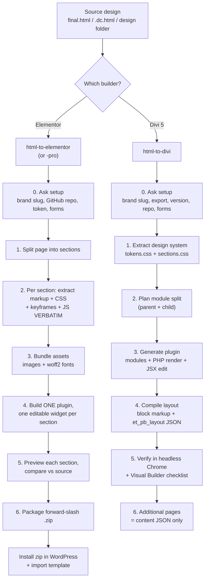

# WordPress Page — HTML → Elementor / Divi Skills

A collection of **3 AI agent skills** that take a finished web page (HTML + CSS + JS + assets) and
rebuild it inside WordPress as **pixel-exact, editable** builder content:

| Skill | What it builds | Target builder | Output |
| --- | --- | --- | --- |
| [`html-to-elementor`](html-to-elementor/SKILL.md) | Every section as its own editable widget | **Elementor** (free) / Elementor Pro | One WordPress plugin + templates |
| [`html-to-elementor-pro`](html-to-elementor-pro/SKILL.md) | Same as above (Pro-tuned profile) | **Elementor Pro** | One WordPress plugin + templates |
| [`html-to-divi`](html-to-divi/SKILL.md) | Reusable Divi 5 custom modules | **Divi 5** (builderVersion 5.x) | One plugin + Divi Library layout |

These skills run inside an agentic coding tool (OpenCode, Claude Code, etc.). The agent **builds and
packages** a WordPress plugin; you then install the resulting `.zip` on your site. The skills never
touch your live WordPress site directly.

> **The core rule: lift, don't re-derive.** The source HTML is the spec. The agent must read the real
> colors, spacing, fonts and markup out of the source — never guess them from a screenshot. Guessing
> is what produces "tiny differences" that compound across 10+ sections.

---

## Why this exists

Rebuilding a designed page by hand in Elementor or Divi is slow and drifts from the original.
These skills encode a **repeatable, verified process** so every project starts at expert level:

- each section becomes its **own editable widget / module** (selectable, reorderable, with controls),
- fonts, spacing, colors **and animations** (hover, scroll-reveal, sliders, keyframes) are preserved,
- assets (images, fonts) are **bundled into the plugin**, so nothing breaks offline,
- a **GitHub auto-updater** is baked in so the plugin updates with one click from WordPress,
- the plugin is packaged with a **correct forward-slash zip** (avoids the classic "Plugin file does
  not exist" Windows bug).

---

## How it works (high level)



See [`docs/HOW-IT-WORKS.md`](docs/HOW-IT-WORKS.md) for the detailed step-by-step and
[`docs/WORKFLOW.md`](docs/WORKFLOW.md) for the full process graph per skill.

---

## Requirements

| Need | Purpose |
| --- | --- |
| **OpenCode** (free) or Claude Code | Runs the skill / agent |
| **Node.js + npm** | Build tooling (webpack, layout compiler) |
| **PHP CLI** | Divi module render harnesses / validation |
| **Git + GitHub CLI (`gh`)** | Repo, releases, auto-updater |
| **Headless Chrome** | Visual verification against the source |
| **WordPress** with **Elementor** and/or **Divi 5** | Where the plugin is installed |

---

## Quick start

1. **Install OpenCode** (free) — see [`SETUP-GUIDE.md`](SETUP-GUIDE.md).
2. **Install the skills** by copying the folders into your OpenCode skills directory:

   ```bash
   # global (all projects)
   cp -r html-to-elementor html-to-elementor-pro html-to-divi ~/.config/opencode/skills/
   ```

   ```powershell
   # Windows PowerShell
   Copy-Item -Recurse html-to-elementor,html-to-elementor-pro,html-to-divi "$env:USERPROFILE\.config\opencode\skills\"
   ```

3. **Open OpenCode** in the folder that holds your design source and ask it to build:

   ```
   Use the html-to-elementor skill. final.html is the source. Build the WordPress plugin.
   ```

   Or use the slash command (these skills expose one):

   ```
   /html-to-elementor
   ```

4. The agent asks a few setup questions, then generates the plugin. **Install the `.zip`** on your
   WordPress site and import the template.

Full instructions: [`SETUP-GUIDE.md`](SETUP-GUIDE.md).

---

## Repo layout

```
.
├── README.md                     ← you are here
├── SETUP-GUIDE.md                ← install OpenCode + these skills, run a build
├── docs/
│   ├── HOW-IT-WORKS.md           ← detailed explanation of each skill
│   └── WORKFLOW.md               ← process graphs (mermaid)
├── html-to-elementor/
│   ├── SKILL.md                  ← the playbook the agent follows
│   └── reference/                ← verbatim copy-in PHP (updater, template registrar)
├── html-to-elementor-pro/
│   ├── SKILL.md
│   └── reference/
└── html-to-divi/
    ├── SKILL.md
    └── reference/                ← working plugin scaffold + tools + src
```

---

## License

MIT — see [LICENSE](LICENSE). Built for WordPress designers and developers who want their
hand-built pages to be reproducible, editable and maintainable.
