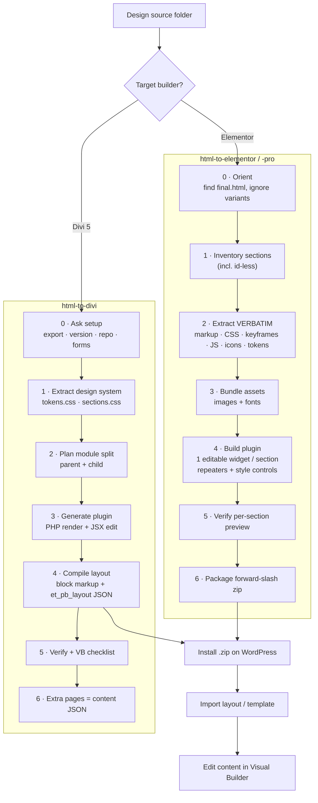
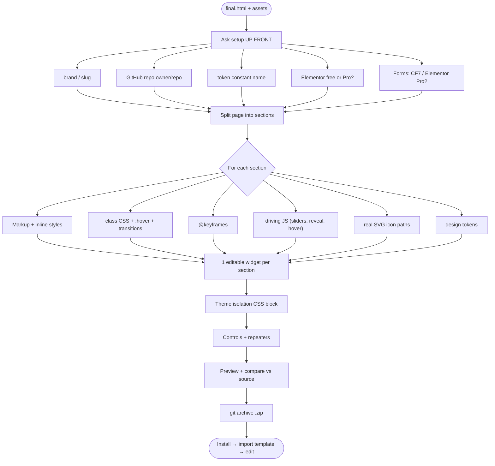
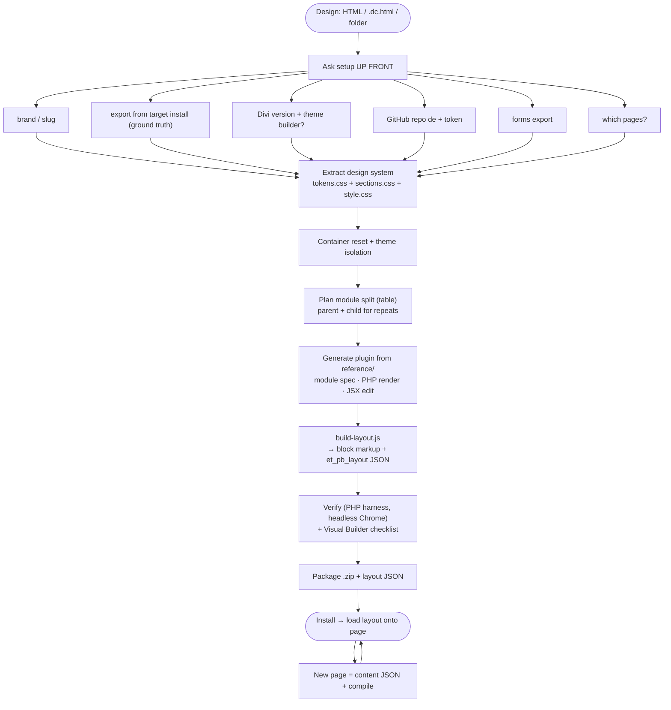
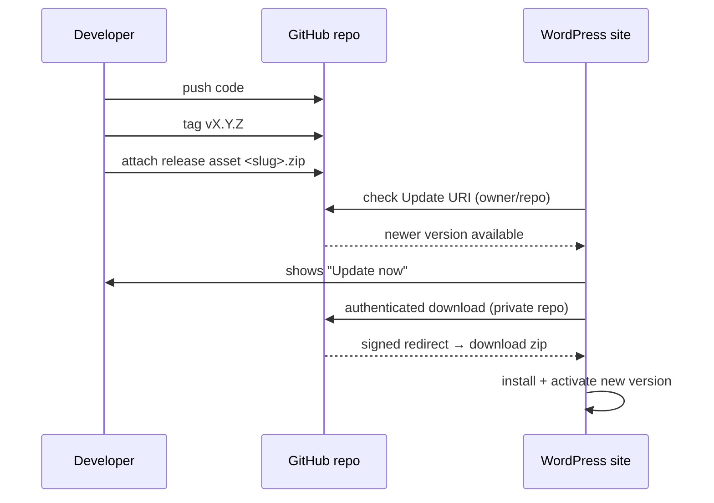
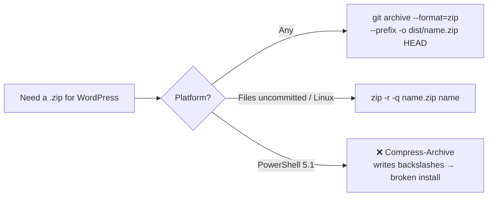

# Workflow — Process Graphs

Visual process graphs for each skill. (Rendered as Mermaid diagrams on GitHub.)

---

## Master workflow

---

## Elementor skill — detailed

---

## Divi skill — detailed

---

## Auto-updater flow (both stacks)

> The asset must be named **exactly `<slug>.zip`** — versioned filenames break the updater
> (HTTP 415 on the zipball fallback).

---

## Packaging decision

